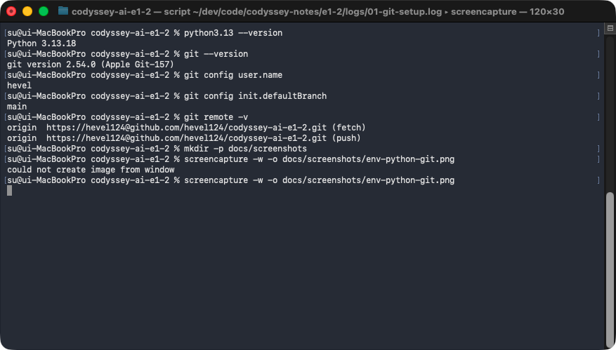
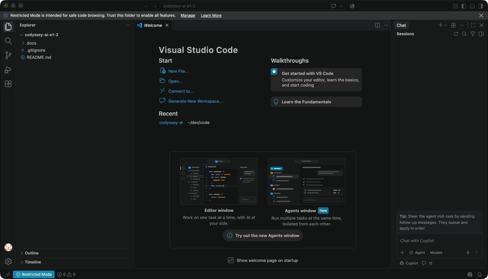
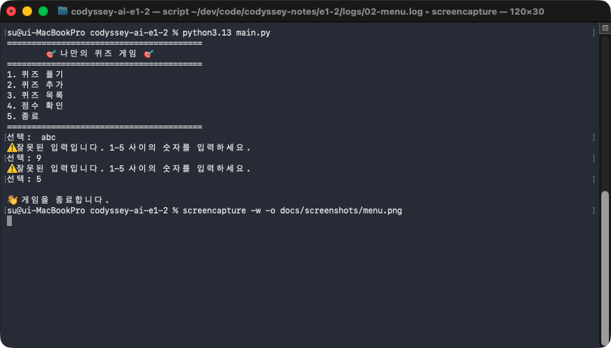
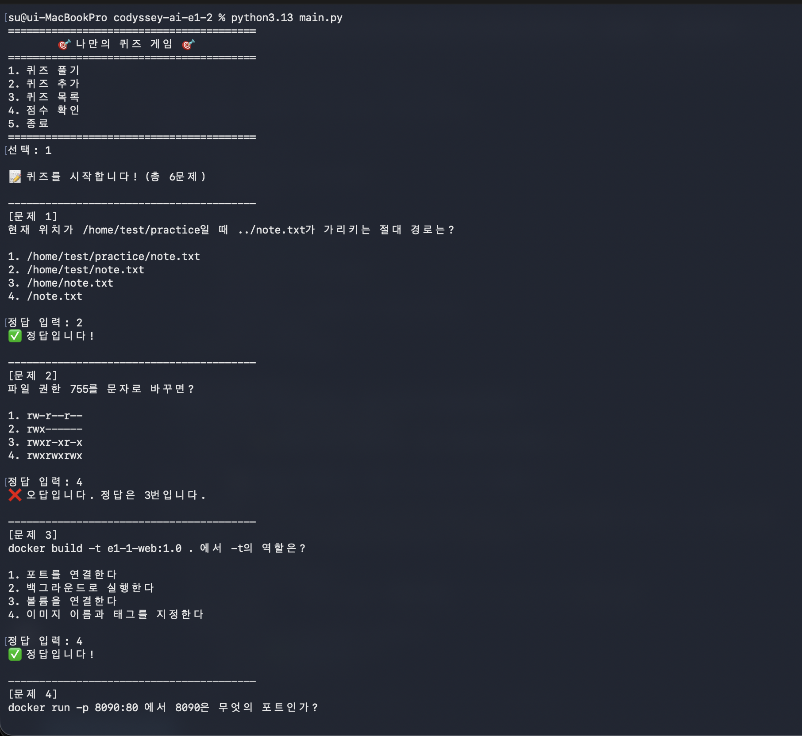
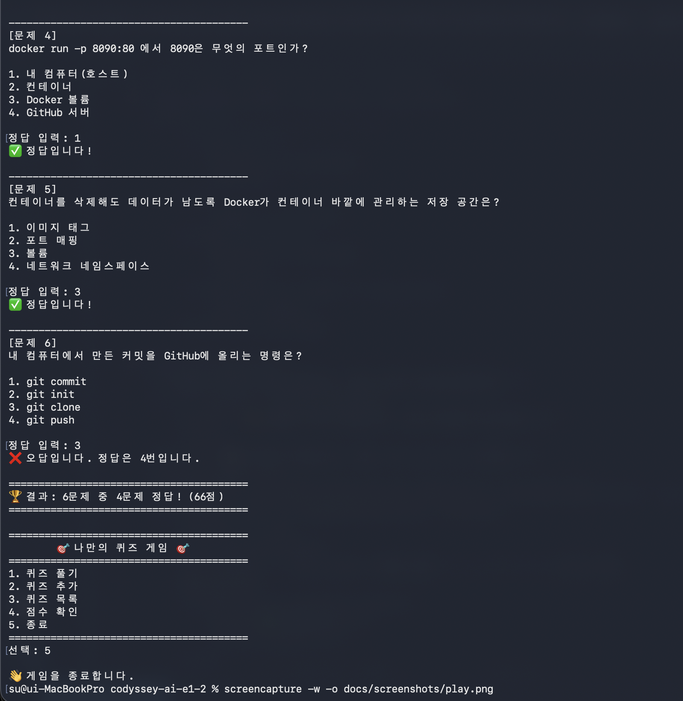
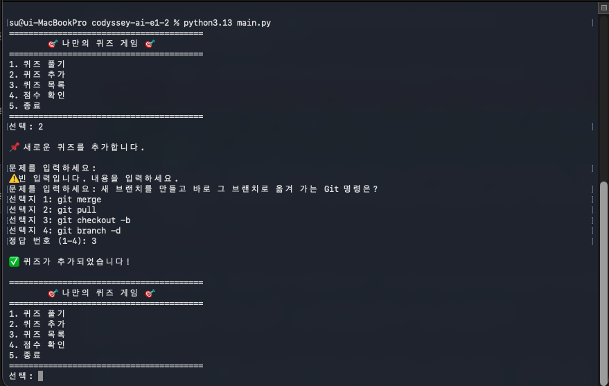
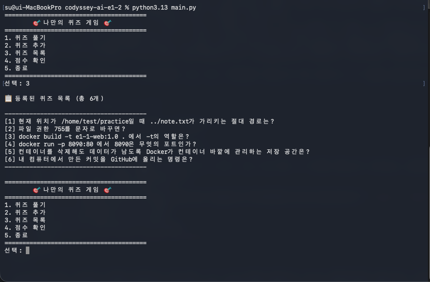
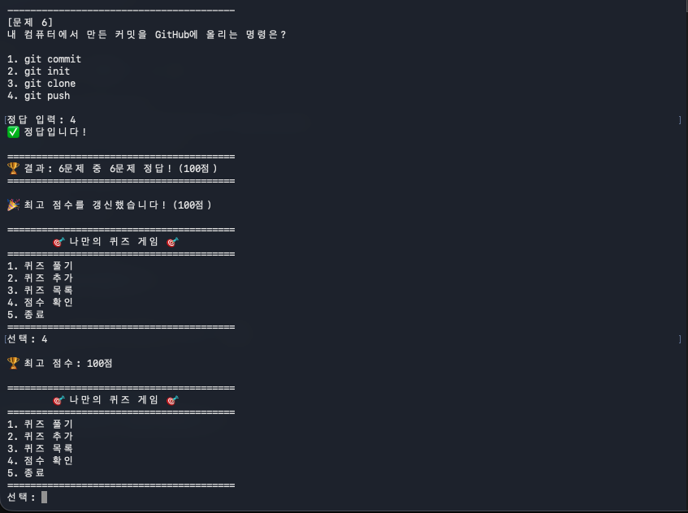

# 나만의 퀴즈 게임

## 1. 프로젝트 개요
- 터미널에서 동작하는 객관식 퀴즈 게임 (Python 콘솔 프로그램)
- 메뉴에서 번호를 골라 퀴즈 풀기 · 퀴즈 추가 · 퀴즈 목록 · 점수 확인 · 종료
- 퀴즈와 최고 점수를 프로젝트 루트의 `state.json`에 저장해, 종료 후 다시 실행해도 유지
- 클래스 2개(`Quiz`, `QuizGame`)로 역할 분리
- 저장소: https://github.com/hevel124/codyssey-ai-e1-2

## 2. 퀴즈 주제와 선정 이유
- 주제: 개발 환경 기초 (터미널·Docker·Git)
- 선정 이유: 앞 미션(e1-1)에서 배운 내용 복습. 경로, 파일 권한, Docker 이미지·포트·볼륨, Git push를 문제로 만들어 다시 확인
- 기본 퀴즈 6개 (4지선다)

## 3. 실행 방법
실행 환경
- Python 3.10 이상 (개발: Python 3.13.18, macOS)
- 외부 라이브러리 없음 (표준 라이브러리 `json`, `pathlib`만 사용)

**저장소 받기**
```bash
$ git clone https://github.com/hevel124/codyssey-ai-e1-2.git
$ cd codyssey-ai-e1-2
```

**Python 버전 확인**
```bash
$ python3 --version
```
- 3.10 미만이면 3.10 이상 버전의 실행 명령(예: `python3.13`)으로 아래 `python3`을 바꿔 실행

**실행**
```bash
$ python3 main.py
```
- 종료: 메뉴 `5`. Ctrl+C 또는 Ctrl+D로 끝내도 안내 메시지 출력 후 저장하고 종료

개발 환경 설정 화면
- Python 버전 · Git 설정: `docs/screenshots/env-python-git.png`
- VSCode: `docs/screenshots/env-vscode.png`




## 4. 기능 목록

| 메뉴 | 기능 | 동작 |
|---|---|---|
| 1 | 퀴즈 풀기 | 저장된 퀴즈를 순서대로 출제, 정답·오답 안내, 끝나면 맞힌 개수와 점수(100점 만점) 표시, 최고 점수 갱신 |
| 2 | 퀴즈 추가 | 문제 · 선택지 4개 · 정답 번호(1~4)를 입력받아 추가, 바로 `state.json`에 저장 |
| 3 | 퀴즈 목록 | 등록된 퀴즈의 번호와 문제 출력 |
| 4 | 점수 확인 | 최고 점수 출력, 기록이 없으면 안내 |
| 5 | 종료 | 프로그램 종료 |

입력·오류 처리
- 숫자 입력: 앞뒤 공백 제거 후 처리. 빈 입력 · 숫자가 아닌 입력(`abc`) · 범위 밖 숫자(메뉴 `9`, 정답 `0`)는 안내 메시지 출력 후 다시 입력
- 퀴즈 추가의 문제·선택지: 빈 입력이면 안내 후 다시 입력
- 퀴즈가 하나도 없으면 풀기·목록에서 안내 메시지 출력
- Ctrl+C(`KeyboardInterrupt`) · 입력 종료(`EOFError`): 안내 메시지 출력, 저장 후 정상 종료
- `state.json`이 없거나 손상: 6절 참고

실행 화면

**메뉴** (`docs/screenshots/menu.png`)



**퀴즈 풀기** (`docs/screenshots/play-1.png`, `docs/screenshots/play-2.png`)




**퀴즈 추가** (`docs/screenshots/add_quiz.png`)



**퀴즈 목록** (`docs/screenshots/list.png`)



**점수 확인** (`docs/screenshots/score.png`)



## 5. 파일 구조
```text
codyssey-ai-e1-2/
├── main.py              # 게임 전체 코드
├── README.md
├── .gitignore           # state.json, __pycache__/ 등 제외
├── state.json           # 실행하면 생성 (커밋 안 함)
└── docs/
    └── screenshots/     # 개발 환경 · 실행 화면 캡처
```

`main.py` 구성

| 구분 | 이름 | 역할 |
|---|---|---|
| 클래스 | `Quiz` | 퀴즈 1개(문제 `question` · 선택지 `choices` · 정답 번호 `answer`). `display` 문제 출력, `is_correct` 정답 확인, `to_dict` 저장용 dict 변환 |
| 클래스 | `QuizGame` | 게임 전체 관리. 속성 `quizzes`(퀴즈 목록) · `best_score`(최고 점수) |
| 메서드 | `QuizGame.show_menu` | 메뉴 출력 |
| 메서드 | `QuizGame.play_quiz` | 퀴즈 풀기 |
| 메서드 | `QuizGame.add_quiz` | 퀴즈 추가 |
| 메서드 | `QuizGame.show_quizzes` | 퀴즈 목록 |
| 메서드 | `QuizGame.update_best_score` · `show_score` | 최고 점수 갱신 · 점수 확인 |
| 메서드 | `QuizGame.load_state` · `save_state` | `state.json` 불러오기 · 저장 |
| 메서드 | `QuizGame.run` | 메뉴 반복, 선택한 번호의 메서드 실행 |
| 함수 | `make_default_quizzes` | 기본 퀴즈 6개 생성 |
| 함수 | `read_number` · `read_text` | 숫자 · 글자 입력 처리 (재입력 포함) |
| 함수 | `main` | `QuizGame` 실행, Ctrl+C · EOF 처리 |

## 6. 데이터 파일 설명 (`state.json`)
- 경로: 프로젝트 루트의 `state.json` (`main.py`와 같은 폴더. 실행 위치와 상관없이 같은 곳)
- 역할: 퀴즈 목록과 최고 점수 저장. 다음 실행 때 불러와 이어서 사용
- 인코딩: UTF-8 (한글을 `\u` 코드 없이 그대로 저장)
- 저장 시점: 퀴즈 추가 직후 · 퀴즈 풀기 끝난 뒤 · Ctrl+C/EOF로 종료할 때
- 커밋하지 않음 (`.gitignore`에 포함, 실행하면 생성)

스키마

| 키 | 형식 | 내용 |
|---|---|---|
| `quizzes` | list | 퀴즈 목록. 항목마다 아래 3개 키 |
| `quizzes[].question` | str | 문제 |
| `quizzes[].choices` | list (str 4개) | 선택지 |
| `quizzes[].answer` | int (1~4) | 정답 번호 |
| `best_score` | int 또는 `null` | 최고 점수(100점 만점). 푼 기록이 없으면 `null` |

형식 예시 (퀴즈 1개만 표시)
```json
{
    "quizzes": [
        {
            "question": "파일 권한 755를 문자로 바꾸면?",
            "choices": ["rw-r--r--", "rwx------", "rwxr-xr-x", "rwxrwxrwx"],
            "answer": 3
        }
    ],
    "best_score": 100
}
```

파일이 없거나 손상된 경우
- 없음(첫 실행): `📂 저장된 데이터가 없어 기본 퀴즈로 시작합니다.` 출력, 기본 퀴즈 6개로 실행
- 손상(JSON 문법 오류 · 키 없음 등) 또는 읽기 실패: `⚠️ 저장 파일이 손상되었거나 읽을 수 없어 기본 퀴즈 데이터로 복구합니다.` 출력, 기본 퀴즈 6개로 계속 실행
- 쓰기 실패: `⚠️ state.json에 저장하지 못했습니다.` 출력, 게임은 계속

## 7. 과제 목표 정리

**Python 기초**
- 변수: 값에 이름을 붙여 저장하는 것. 같은 값을 여러 곳에서 다시 쓰고, 실행 중 바뀌는 값(점수 등)을 기억하기 위해 사용
- 자료형
  - `int`: 정수 (예: `3`)
  - `str`: 글자 (예: `"git push"`)
  - `bool`: 참/거짓 `True`/`False`
  - `list`: 순서가 있는 여러 값, 번호(0부터)로 꺼냄 (예: 선택지 4개)
  - `dict`: 키와 값의 쌍, 키 이름으로 꺼냄 (예: `{"answer": 3}`)
- `if/elif/else`: 조건을 위에서부터 검사해 처음 참인 블록 하나만 실행. 모두 거짓이면 `else` 실행
- `for`와 `while`
  - `for`: 정해진 묶음(list 등)을 하나씩 꺼내 반복. 반복 횟수가 정해져 있을 때 사용 (예: 퀴즈를 차례로 출제)
  - `while`: 조건이 참인 동안 반복. 언제 끝날지 미리 모를 때 사용 (예: 올바른 숫자가 들어올 때까지 다시 묻기)
- 함수: `def`로 정의한 코드 묶음. 매개변수로 값을 받고 `return`으로 결과(반환값)를 돌려줌

**클래스와 객체**
- 클래스: 데이터(속성)와 그 데이터를 다루는 기능(메서드)을 하나로 묶은 틀. 이 틀로 만든 실제 값이 객체. 관련된 데이터와 기능을 한곳에 모아 역할별로 코드를 나누기 위해 사용
- `__init__`: 객체를 만들 때 자동으로 한 번 실행되어 속성의 처음 값을 채우는 메서드
- `self`: 메서드를 호출한 그 객체 자신. `self.속성`으로 그 객체의 값을 읽고 바꿈
- 속성: 객체가 가진 값 (예: `self.question`). 메서드: 클래스 안에 정의한 함수, 첫 매개변수가 `self` (예: `is_correct`)

**파일 입출력**
- 파일 처리 과정: `open()`으로 열기 → 읽기(`"r"`) 또는 쓰기(`"w"`, 기존 내용 덮어씀) → 닫기. `with open(...) as file:`을 쓰면 블록이 끝날 때 자동으로 닫힘. 한글을 위해 `encoding="utf-8"` 지정
- JSON: list·dict 같은 데이터를 글자로 적는 형식. 프로그램이 끝나면 사라지는 메모리 속 데이터를 파일로 남기고 다시 읽어 오기 위해 사용. 사람이 열어 읽을 수 있고 Python 표준 라이브러리 `json`으로 처리 (`json.dump` 저장, `json.load` 불러오기)
- `try/except`: 오류가 날 수 있는 코드를 `try`에 두고, 지정한 오류가 나면 프로그램을 멈추지 않고 `except` 블록 실행 (예: `int("abc")`의 `ValueError` → 다시 입력)

**Git 기초**
- Git: 파일의 변경 이력을 커밋 단위로 기록하는 버전 관리 도구. 이전 상태로 되돌리거나, 무엇이 언제 왜 바뀌었는지 확인하고, 다른 사람과 같은 코드를 나눠 작업하기 위해 필요
- 명령 7종

| 명령 | 하는 일 |
|---|---|
| `git init` | 현재 폴더를 Git 저장소로 만듦 |
| `git add` | 커밋에 넣을 변경 파일을 선택(스테이징) |
| `git commit` | 선택한 변경을 메시지와 함께 이력으로 기록 |
| `git push` | 로컬 커밋을 원격 저장소(GitHub)에 올림 |
| `git pull` | 원격 저장소의 새 커밋을 받아 로컬에 합침 |
| `git checkout` | 다른 브랜치로 이동 (`-b`면 새 브랜치를 만들고 이동) |
| `git clone` | 원격 저장소 전체를 새 로컬 폴더로 복제 |

- 브랜치 생성과 병합: `git checkout -b <브랜치>`로 갈라져 작업 → `git checkout main`으로 돌아옴 → `git merge <브랜치>`로 합침
- clone과 pull: `git clone <URL>`로 원격 저장소를 처음 받고, 이후 원격에 생긴 변경은 `git pull`로 가져옴
